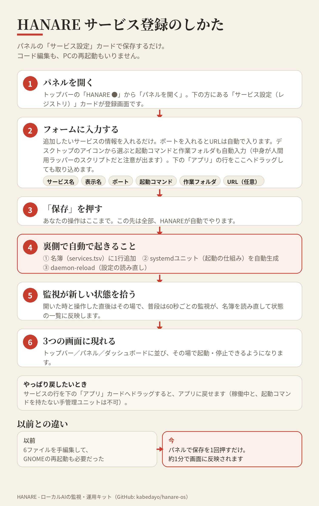

# HANARE

### A split-GPU AI OS — the human keeps the main house, the AI lives in the annex.

*Hanare* (離れ) is a detached annex on the same premises as a main house. **HANARE** applies that to one PC: split it into two worlds.

- **Human side** — a normal Linux desktop for games, browser, and daily use.
- **AI side** — a headless, API-first Linux environment where local LLMs and image generation live permanently, on their own GPU.

No more humans and AI fighting over the same desktop, the same GPU, and the same VRAM.

> Status: **v0.1 — implemented and in daily use on the author's machine.**
> HANARE v0.1 is an Ubuntu setup kit plus a small runtime, not a bootable ISO (yet). See the layers below for what is real today and what is still roadmap.

## What v0.1 does

- **See** — captures the state of the AI services every 60 seconds (`running` / `stopped` / `degraded` / `stuck-suspect`), per-process VRAM/RAM usage, and appends everything to a JSONL event log. No automatic kills: visibility first.
- **Surfaces** — three views of the same state:
  - a GNOME top bar pill (`HANARE ●`, dot colour = worst current state) with a menu,
  - a native panel window (GTK) for day-to-day control,
  - a local web dashboard on `127.0.0.1:8790`.
- **Manage** — start / stop / restart the LLM core and the image service as systemd user units; switch the LLM by editing one registry row; launch your local AI apps from the panel or dashboard.

## Adding a service

Services live in one registry (`services/services.tsv`) — you never edit code to add one. Open the panel's **Service settings (registry)** card, fill in the form (picking a desktop icon fills in the launch command, and the URL is derived from the port), or drag an app from the panel's app list onto the services card. Saving generates the systemd unit for you, and the new entry appears in the top bar, the panel and the dashboard. Dragging a service back onto the apps card demotes it to a plain app again.

## Layers (the honest version)

| Layer | What | State |
|---|---|---|
| L1 | Visibility: capture, event log, status surfaces | ✅ done |
| L2 | Management: systemd units, model registry, app launcher | ✅ done |
| L3 | Platform: GPU pinning + VRAM policy as code | 🚧 partial (policy documented, enforcement manual) |
| L4 | A bootable HANARE OS image | 🗺 roadmap |

## Quick start

Prerequisites: Ubuntu with GNOME, systemd user sessions, and (for the AI side) an NVIDIA GPU with a working `llama-server` build and/or ComfyUI — HANARE manages your stack, it does not install the models for you.

1. Clone this repository to `~/hanare-os` (the top bar extension looks for the checkout there).
2. Make the samples yours:
   - `cp models/models.tsv.example models/models.tsv` — register your GGUF files.
   - `cp scripts/llama-env.example.sh runtime/llama-env.sh` — point it at your `llama-server`.
   - `cp systemd/hanare-comfyui.service.example systemd/hanare-comfyui.service` — set your ComfyUI paths.
   - `cp apps.d/*.app.example` files to `*.app` — register your local AI apps.
3. Run the installers in order: `setup/10-install-capture.sh`, `11-install-dashboard.sh`, `12-install-topbar.sh`, `13-install-services.sh`, `14-install-panel.sh`.
4. Pick a model with `bash scripts/hanare-model.sh use <name>`, then start the LLM from the panel, the top bar menu, or `systemctl --user start hanare-llama`.

## Local configuration stays local

Everything machine-specific — your model files, your paths, your app definitions, your service state — lives in files that are **git-ignored** (`models/models.tsv`, `runtime/`, `apps.d/*.app`, `systemd/hanare-comfyui.service`, `docs/tasks/`). The repository ships samples only, so a clone never contains the author's models or home layout. Adding a model is one row in `models.tsv`; every UI picks it up automatically.

## Layout

- `feed/` — the 60-second capture and the event feed
- `status/` — status rendering helpers
- `dashboard/` — the web dashboard (127.0.0.1:8790)
- `panel/` — the native GTK panel window
- `topbar/` — the GNOME Shell extension source (installed into the VRAM/RAM Monitor extension)
- `systemd/` — user units (ComfyUI unit ships as an example)
- `scripts/` — model registry CLI and the llama runner
- `models/` — the model registry (`models.tsv`, local) and its sample
- `apps.d/` — app definitions (local) and samples
- `setup/` — idempotent installers
- `tests/` — shell checks (`check-*.sh`)

## License

MIT — see [LICENSE](LICENSE).
